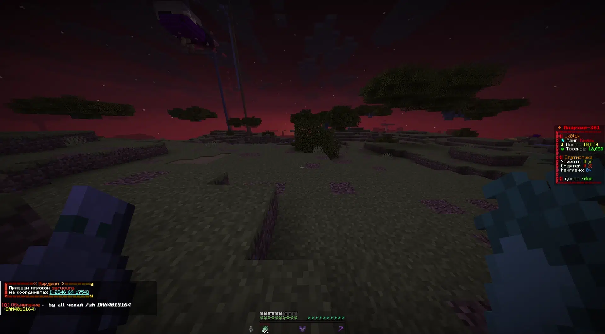
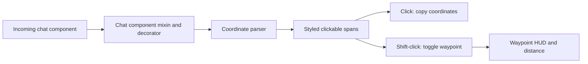

<div align="center">
<h1>ClickCoords</h1>
<hr>
<strong>3 chat tools in one place: coordinate recognition, clipboard copying, temporary waypoints</strong>
<p>


</p>
<p>
<a href="https://github.com/hhhhhffd/ClickCoords/releases/latest"></a>
<a href="https://github.com/hhhhhffd/ClickCoords/releases"></a>
<a href="LICENSE"></a>
</p>
<p><a href="https://github.com/hhhhhffd/ClickCoords/releases">Download</a> · <a href="#architecture">Architecture</a> · <a href="#build">Build</a></p>
</div>



## Summary

ClickCoords is a client-side Fabric mod for Minecraft Java 1.21.11. It recognizes coordinates in chat, highlights them in aqua and makes them clickable for copying, and can display a temporary waypoint without sending chat messages or executing commands.

## Technical Stack

| Component | Version or role |
| --- | --- |
| Minecraft Java | 1.21.11 |
| Fabric Loader | 0.20.1 used for development; 0.18.4 or newer required |
| Fabric API | 0.141.6+1.21.11 used for development; 0.141.6 or newer required |
| Java | 21 or newer |
| Fabric Loom / Gradle | 1.13.6 / 9.2.1 wrapper |

## Architecture



- The parser returns spans and normalized values rather than interpreting chat as commands; it limits message length and match count.
- The decorator preserves existing server or plugin click actions by default. Explicitly identified coordinates get a local copy action on the coordinate span; links outside it stay intact.
- Waypoints are client-side and temporary: they expire after five minutes, on dimension change, or on server disconnect.

## Project Structure

```text
.
├── build.gradle          # Fabric Loom build and regression tasks
├── gradle.properties     # Minecraft, loader, API and mod versions
├── gradle/               # Gradle wrapper
├── docs/media/           # Preview image
├── src/
│   ├── client/           # Parser, chat integration and waypoint HUD
│   └── main/             # Mod metadata and mixin configuration
└── tests/                # Parser and chat decoration regression tests
```

## Installation and Usage

1. Run Minecraft Java **1.21.11** with Fabric Loader 0.18.4 or newer.
2. Download the JAR from [Releases](https://github.com/hhhhhffd/ClickCoords/releases) and put it and Fabric API for 1.21.11 in the client `mods` folder. The server does not need the mod.
3. Open chat and left-click highlighted coordinates to copy `x y z` or `x z`. Shift-click to place a colored waypoint with distance; Shift-click the same coordinates again to remove it, or different coordinates to move it. For an X/Z pair, the waypoint uses the player's current Y position.

Recognized examples include `Event spawned at X: -120, Y: 70, Z: 345`, `(-12, 64, 245)`, `на кордах 780 2500`, `[-1494 113 -2134]`, `X: 780, Z: 2500`, and numeric-only chat bodies such as `<Player> 100 400` or `[Князь] Player ➜ 100 400`. Plain space-separated numbers in ordinary prose without a coordinate cue are not highlighted.

## Build

Use JDK 21 from the project root. The build produces JARs in `build/libs`.

```sh
./gradlew build
```

On Windows use `gradlew.bat build`. The Gradle `check` task includes parser and chat decoration regression tasks. To run the standalone parser test without launching Minecraft:

```sh
mkdir -p build/parser-test
javac -d build/parser-test src/client/java/com/clickcoords/CoordinateParser.java tests/CoordinateParserTest.java
java -cp build/parser-test CoordinateParserTest
```

## Links

- [Source repository](https://github.com/hhhhhffd/ClickCoords)
- [Releases and downloads](https://github.com/hhhhhffd/ClickCoords/releases)

## License

Licensed under the [MIT License](LICENSE).
